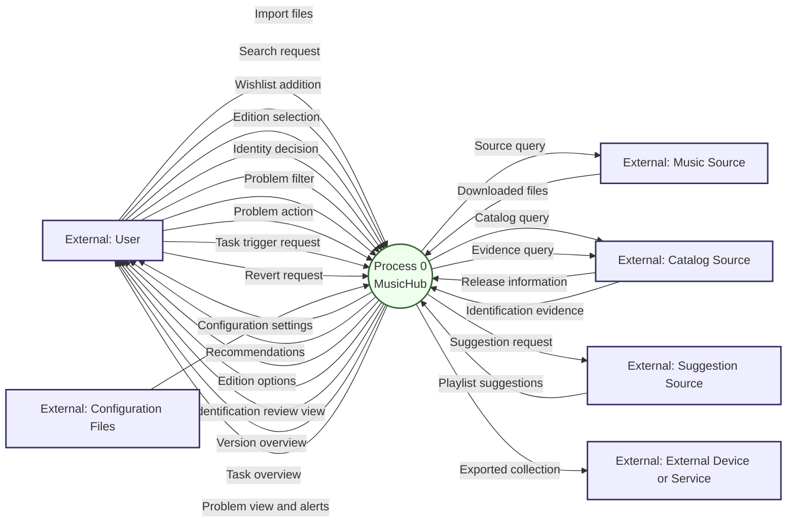
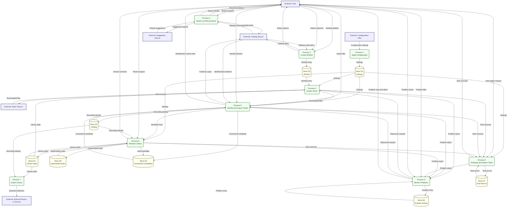
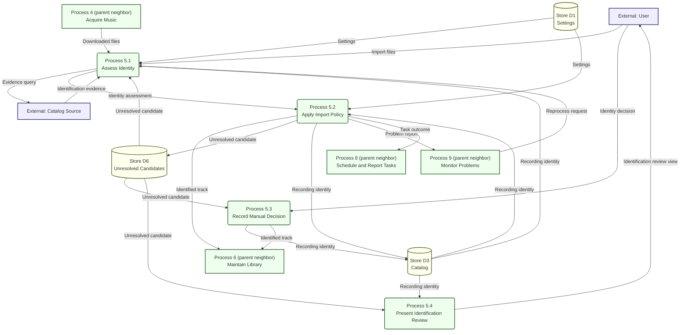
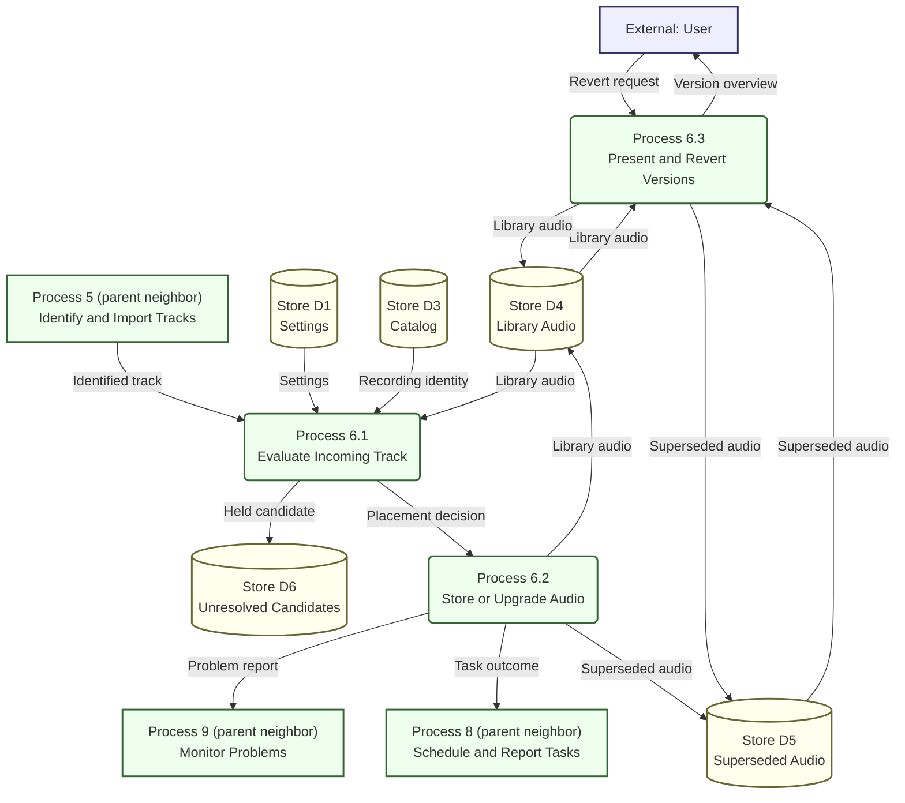
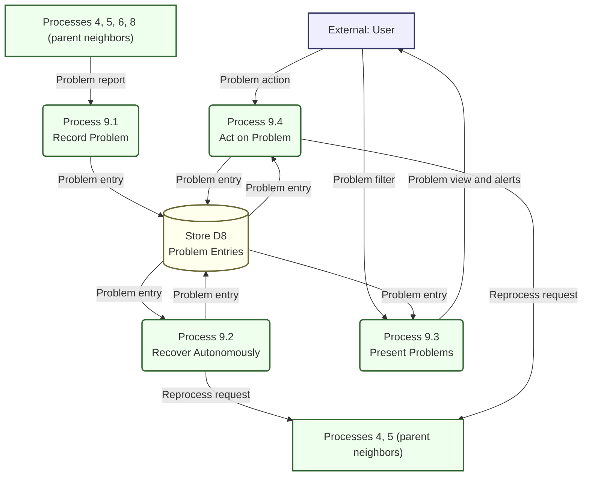

# MusicHub structured analysis

> **Experimental projection.** Generated from `logs/` only, in the style of Yourdon's *Just Enough Structured Analysis*. It models the **essential requirements** of the intended system (what must happen, what data it needs), not implementation, delivery phases or technology. It is not a source of truth; the logs are. Diagrams marked **partial** rest on incomplete evidence, and flows were not invented to fill the gaps.

Conventions: in diagrams, **Process**, **Store** and **External** appear in each node label. Arrows are *data flows* only. Scheduling or retry activation is control, not data, and is described in the process specifications instead of being drawn. Where the same flow name appears on a store arrow, it means "the data of that store" being written or read.

## 1. Purpose, scope and external actors

**Purpose.** MusicHub builds and manages its own authoritative music library for one user. It acquires wanted music, identifies each recording, keeps one canonical audio copy per recording and its quality history, and offers exports for use elsewhere, with as little manual work as correctness allows. Exceptional cases are collected for attention. (`logs/2026-10-17-20-00-00-managed-library-boundary.md`, `logs/2026-10-17-20-05-00-library-authoritative-v1.md`, `logs/2026-10-17-20-15-00-import-identification-and-release-metadata.md`)

**In scope.** Managed library and import; identification with confidence and provenance; quality profiles and upgrades; retained superseded versions; wishlist, search and recommendations; acquisition; export; central scheduler; central problem dashboard; file-based configuration.

**Out of scope or excluded (accepted).**
- The user's original NAS collection is never accessed or scanned (`logs/2026-10-17-20-00-00-managed-library-boundary.md`).
- Two-way synchronization: changes on phones or synchronized copies never alter the library in version 1 (`logs/2026-10-17-20-05-00-library-authoritative-v1.md`).
- Autonomous addition of music to the wishlist (`logs/2026-10-17-20-40-00-user-curated-wishlist.md`, `logs/2026-10-17-20-45-00-music-search-recommendations-and-playlist-ai.md`).

| External entity | Role |
|---|---|
| User | Supplies files, searches, curates wishlist, selects editions, confirms identities, handles problems, triggers tasks. |
| Configuration Files | Deployment-managed files/environment; MusicHub must be fully configurable without the UI (`logs/2026-10-17-20-11-00-file-based-configuration.md`). |
| Music Source | Provider(s) from which music files are searched and obtained. Undecided which. |
| Catalog Source | Provider(s) of release/track information and identification evidence. Undecided which. |
| Suggestion Source | AI that constructs playlists and suggests music, including music not in the library. Undecided whether internal or external. |
| External Device or Service | Phone, or a service such as Google Drive, that reads or copies exported files. Read-only with respect to the library. |

## 2. Context diagram (Level 0)

Status: adequate for the accepted decisions; the sources are placeholders for unresolved providers.

## 3. Level 1 DFD: MusicHub

Status: **partial**. Process 7 has no recorded trigger; Process 9's recovery routing, the Process 2 sources and the playlist-to-wishlist interaction are open (see §8). Level 1 balances against §2: each external flow above enters or leaves exactly one or more processes below with the same name.

### Functional decomposition

- 0 MusicHub
  - 1 Apply Configuration *(leaf)*
  - 2 Search and Recommend *(leaf)*
  - 3 Curate Wishlist *(leaf)*
  - 4 Acquire Music *(leaf)*
  - 5 Identify and Import Tracks → 5.1 Assess Identity, 5.2 Apply Import Policy, 5.3 Record Manual Decision, 5.4 Present Identification Review
  - 6 Maintain Library → 6.1 Evaluate Incoming Track, 6.2 Store or Upgrade Audio, 6.3 Present and Revert Versions
  - 7 Export Library *(leaf)*
  - 8 Schedule and Report Tasks *(leaf)*
  - 9 Monitor Problems → 9.1 Record Problem, 9.2 Recover Autonomously, 9.3 Present Problems, 9.4 Act on Problem

## 4. Level 2 DFD: Process 5, Identify and Import Tracks

Status: adequate for accepted principles; thresholds, workflow steps and quarantine placement are open. Boundary flows balance with Process 5 in §3.

## 5. Level 2 DFD: Process 6, Maintain Library

Status: adequate for accepted principles; replacement policy details are open. Balances with Process 6 in §3 (Process 4 additionally reads D4 as *Library state*, outside this process).

## 6. Level 2 DFD: Process 9, Monitor Problems

Status: **partial**. Which subsystem executes each autonomous retry is not recorded; recovery is modeled as a request back to the originating processes only because the logs require "reprocessing" and autonomous recovery of download and task failures. Balances with Process 9 in §3.

## 7. Process specifications (leaf processes)

Settings (D1) govern all processes that read them; "configured" below means supplied through Settings.

**1 Apply Configuration**
- In: Configuration settings. Out: Settings.
- Rules: Everything operable must be configurable without the UI; any UI must not become a conflicting source of configuration truth.
- Exceptions: Invalid or incomplete configuration is unspecified.

**2 Search and Recommend**
- In: Search request, Release information, Playlist suggestions. Out: Catalog query, Suggestion request, Search results, Recommendations.
- Rules: Users search in-app and choose results for the wishlist (via process 3). Recommendations, including AI playlists that may contain music not in the library, are suggestions only and never add to the wishlist.
- Exceptions: Source unavailable (reported by owning process; handling unspecified).

**3 Curate Wishlist**
- In: Wishlist addition, Edition selection, Release information. Out: Catalog query, Edition options, Wishlist entry.
- Rules: Only the user adds entries. Adding an album resolves its track list and requests its constituent tracks; adding a track or an artist does not imply a whole album or discography. For an album the user chooses the edition; the standard/original release is listed first as the suggested default; no edition is substituted silently.
- Exceptions: Missing track list or ambiguous album identity is unspecified.

**4 Acquire Music**
- In: Wishlist entry, Library state, Settings, Reprocess request, Downloaded files. Out: Source query, Downloaded files (to 5), Task outcome, Problem report.
- Rules: Runs on schedule or manual trigger (control, via process 8). Searches for missing wanted tracks and for better versions of tracks below their quality cutoff; missing tracks have higher priority and/or frequency; tracks at their cutoff need no upgrade searches. Only wishlist items are sought. A whole album package may be acquired even if partly present. Selected edition and identity are respected.
- Exceptions: Transient source or download failure is reported and recovered autonomously where possible; wanted tracks still missing remain eligible for later searches.

**5.1 Assess Identity**
- In: Import files, Downloaded files, Reprocess request, Unresolved candidate, Identification evidence, Recording identity, Settings. Out: Evidence query, Identity assessment.
- Rules: Embedded metadata is untrusted evidence; existing artist/title are only search hints. The aim is the exact recording/version, preferring the original single release if it truly contains it, otherwise the original album release. The ordered, configurable steps add evidence toward a candidate confidence and may skip costly steps once confidence suffices. Provenance (candidate, evidence, checks, confidence) is retained. Processing is per track, never per package. Only files supplied by the user or acquired are examined (never the NAS).
- Exceptions: No usable candidate yields a very low confidence assessment.

**5.2 Apply Import Policy**
- In: Identity assessment, Recording identity, Settings. Out: Identified track, Unresolved candidate, Recording identity, Problem report, Task outcome.
- Rules: High confidence goes on automatically. Intermediate confidence also goes on, but its uncertainty is recorded and stays visible for review. Very low confidence is not imported as an identified track; the source file is kept as an unresolved candidate. A manually confirmed identity (certainty 100%, kept distinct from measured confidence) is never overwritten by automation; repeated contradiction produces an alert-level Problem report and leaves the identity unchanged. Content-hash equality is not musical identity.
- Exceptions: Uncertain or conflicting outcomes are reported to process 9.

**5.3 Record Manual Decision**
- In: Identity decision, Unresolved candidate. Out: Recording identity, Identified track.
- Rules: A user's confirmation or correction is recorded with manual provenance and takes precedence over automated results; only a later user decision changes it. A confirmed unresolved candidate may proceed to library evaluation.
- Exceptions: Whether confirmation applies to one file, one recording or equivalent encodings is open.

**5.4 Present Identification Review**
- In: Recording identity, Unresolved candidate. Out: Identification review view.
- Rules: Provides a durable view of identifications that were ever uncertain, including already-imported tracks, with candidate, evidence, checks, confidence and user corrections. Candidates not accepted into the library are also shown.
- Exceptions: None recorded.

**6.1 Evaluate Incoming Track**
- In: Identified track, Recording identity, Library audio, Settings. Out: Placement decision, Held candidate.
- Rules: Per track. Missing tracks are accepted. For an existing recording, compare identity confidence and audio quality separately: a better encoding never displaces a more confidently identified existing recording, and a candidate with stronger identification evidence may be considered further. Upgrade only below the profile cutoff, to a better acceptable quality of the same identified recording/version; never silently substitute a different mix, performance, remaster or edition. Existing audio is kept when the incoming file does not qualify. Uncertain candidates may be held outside the library.
- Exceptions: Both uncertain, or exact replacement rules, are open.

**6.2 Store or Upgrade Audio**
- In: Placement decision. Out: Library audio, Superseded audio, Task outcome, Problem report.
- Rules: One canonical copy per genuinely identical recording/version, independent of artist, album and playlist membership and addressed by content hash; identical content is deduplicated. A replaced file is retained as superseded audio, never deleted automatically.
- Exceptions: Storage failure is reported to process 9.

**6.3 Present and Revert Versions**
- In: Revert request, Library audio, Superseded audio. Out: Version overview, Library audio, Superseded audio.
- Rules: The user can see retained versions with their qualities, upgrade history and the current preferred version, and can revert to an earlier file.
- Exceptions: Interaction between reverting and later upgrade searches is open.

**7 Export Library**
- In: Library audio, Recording identity. Out: Exported collection.
- Rules: Produces a separate export with readable artist/title naming and suitable metadata and release-oriented artwork for external devices; the export duplicates audio, which is acceptable. External copies never change the library.
- Exceptions: Trigger, folder structure, playlist format and synchronization mechanism are unspecified.

**8 Schedule and Report Tasks**
- In: Task trigger request, Task outcome, Settings, Task record. Out: Task record, Task overview, Problem report.
- Rules: One central scheduler for recurring tasks across workflows; schedule and behavior configured through Settings. The user sees planned and running tasks, prior results and next execution, and may trigger a task manually in addition to its schedule. It activates tasks (control).
- Exceptions: Failed or stuck tasks are reported to process 9.

**9.1 Record Problem**
- In: Problem report. Out: Problem entry.
- Rules: Aggregates problems from all subsystems (uncertain recordings, repeated manual-identity conflicts, download/import problems, failed or stuck tasks), showing affected music or task, reason, severity and follow-up actions. Problems appear even while recovery is in progress.
- Exceptions: None recorded.

**9.2 Recover Autonomously**
- In: Problem entry. Out: Problem entry, Reprocess request.
- Rules: Attempts to resolve recoverable (e.g. transient) problems and tracks status: being recovered, needs user action, resolved, recurring. Must not override manual identity confirmations or other user decisions.
- Exceptions: Retry schedules, limits and safe-to-automate classes are open.

**9.3 Present Problems**
- In: Problem filter, Problem entry. Out: Problem view and alerts.
- Rules: Central view, distinct from the scheduler's task overview and focused on exceptions; filterable by status, type, affected music, task, time and severity; resolved and recurring history remains inspectable.
- Exceptions: None recorded.

**9.4 Act on Problem**
- In: Problem action, Problem entry. Out: Problem entry, Reprocess request.
- Rules: The user can address a problem or start reprocessing where applicable.
- Exceptions: Resolution workflows, suppression and audit are open.

## 8. Data dictionary

Attributes are intentionally not defined; none are evidenced by the logs.

### Data stores

| Store | Definition |
|---|---|
| D1 Settings | Effective configuration: quality profiles (acceptable qualities, order, cutoff), identification workflow and confidence policy, search priorities/intervals, task schedules, library and import locations. |
| D2 Wishlist | Entries the user chose to seek: tracks, albums (with chosen edition and constituent tracks) and, if supported, other items. |
| D3 Catalog | Recordings and their identity, release relationships and groupings, independent of embedded tags; identification provenance (candidate, evidence, checks, confidence), uncertainty and manual confirmations. |
| D4 Library Audio | The one canonical preferred audio file per recording/version, addressed by content. |
| D5 Superseded Audio | Previous audio files retained after an upgrade, with quality and upgrade history. |
| D6 Unresolved Candidates | Files not accepted into the library for insufficient identification confidence, kept for later identification (location undecided). |
| D7 Task Record | Planned/running tasks, previous results and next scheduled execution. |
| D8 Problem Entries | Problems with affected music or task, reason, severity, status (recovering, needs action, resolved, recurring), follow-up actions and history. |

### Data flows

| Data flow | Definition |
|---|---|
| Configuration settings | Deployment-managed files/environment values supplied from outside. |
| Settings | Interpreted configuration stored in or read from D1. |
| Import files | Audio files the user supplies through the import location or UI upload. |
| Downloaded files | Audio files, possibly whole album packages, obtained from a Music Source. |
| Search request | The user's in-app query for music. |
| Search results | Matching music, from which the user may select items for the wishlist. |
| Catalog query | Request to the Catalog Source for search matches, albums, editions or track lists. |
| Release information | Albums, editions and track lists returned by the Catalog Source. |
| Suggestion request | Request to the Suggestion Source for suggested music or playlists. |
| Playlist suggestions | AI-generated playlists and music suggestions, possibly not in the library. |
| Recommendations | Suggested music presented to the user; never wishlist additions. |
| Wishlist addition | The user's explicit choice to add an item (track, album or other) to the wishlist. |
| Edition selection | The user's explicit choice of album edition/release. |
| Edition options | Available editions, with the standard/original release first as default suggestion. |
| Wishlist entry | An item in D2, including its resolved scope. |
| Library state | Which wanted music is present and how its quality compares with the cutoff. |
| Source query | Request to the Music Source for wanted music or better versions. |
| Evidence query | Request to the Catalog Source for identification evidence about a file. |
| Identification evidence | Catalog-derived information bearing on a candidate recording's identity. |
| Identity assessment | Candidate identity with confidence and provenance for one track. |
| Identified track | A track accepted for library evaluation, with its identity, confidence/uncertainty and provenance. |
| Recording identity | The D3 data on recordings, identity, provenance and manual confirmations. |
| Identity decision | The user's confirmation, correction or rejection of an identity. |
| Unresolved candidate | A file/track not accepted as identified, with its assessment, in D6. |
| Held candidate | An uncertain candidate retained outside the library by library evaluation, stored in D6. |
| Identification review view | Display of identifications that were uncertain or are unresolved, and their history. |
| Placement decision | Outcome of evaluating a track: accept as new, upgrade, or keep existing. |
| Library audio | The D4 data on canonical audio and its quality. |
| Superseded audio | The D5 data on retained earlier files. |
| Revert request | The user's request to restore an earlier audio version. |
| Version overview | Display of retained versions, qualities, upgrade history and current preferred version. |
| Exported collection | Separate export with readable naming and suitable metadata for external devices. |
| Task trigger request | The user's request to run a task now. |
| Task outcome | Result of a task run reported by a process. |
| Task record | The D7 data on tasks, results and schedule. |
| Task overview | Display of planned, running and previous tasks and next execution. |
| Problem report | A process's notice of an exceptional case. |
| Problem entry | The D8 data on one problem and its status/history. |
| Problem filter | The user's criteria for narrowing the problem view. |
| Problem action | The user's handling of a problem, including initiating reprocessing. |
| Problem view and alerts | Dashboard of problems with filters, status and history, including manual-identity conflict alerts. |
| Reprocess request | Request to retry acquisition or identification for an affected item. |

## 9. Unresolved issues

1. **Sources.** Which Music, Catalog and Suggestion sources exist, and whether in-app search draws on catalog or music sources. (`logs/2026-10-17-20-45-00-music-search-recommendations-and-playlist-ai.md`, `logs/2026-10-17-20-15-00-import-identification-and-release-metadata.md`)
2. **AI playlists.** Inputs to the AI, how unavailable music is referenced, one-click or bulk wishlist addition, and recommendation ranking. (`logs/2026-10-17-20-45-00-music-search-recommendations-and-playlist-ai.md`)
3. **Wishlist.** Viewing, editing and removal of entries, whether artists can be added, when an album expands into tracks, and whether the suggested default edition needs confirmation. (`logs/2026-10-17-20-40-00-user-curated-wishlist.md`, `logs/2026-10-17-20-50-00-explicit-album-wishlist-expansion.md`, `logs/2026-10-17-20-55-00-explicit-album-edition-selection.md`)
4. **Identification.** Steps, thresholds, scoring, treatment of remasters, fingerprint caching, and whether a manual confirmation covers a file, a recording or equivalent encodings. (`logs/2026-10-17-20-20-00-configurable-identification-pipeline.md`, `logs/2026-10-17-21-20-00-manual-identity-authority-and-conflict-alerts.md`)
5. **Unresolved files.** Import folder versus quarantine, retention, retry and review workflow; storage of uncertain candidates and rejected package files. (`logs/2026-10-17-20-25-00-unidentified-files-and-content-addressed-storage.md`, `logs/2026-10-17-21-10-00-per-track-validated-album-import.md`, `logs/2026-10-17-21-15-00-compare-identification-confidence-of-candidates.md`)
6. **Identification review versus problem dashboard.** The logs describe both a durable uncertain-identification review and a dashboard that includes uncertain recordings; whether they are one view is undecided and modeled here as two. (`logs/2026-10-17-20-20-00-configurable-identification-pipeline.md`, `logs/2026-10-17-21-25-00-central-problem-dashboard.md`)
7. **Quality and upgrades.** Attributes, default ranking, profile assignment, whether replacement needs confirmation, equal-uncertainty replacement, and comparison of encoding quality and integrity. (`logs/2026-10-17-20-30-00-audio-quality-profiles.md`, `logs/2026-10-17-21-00-00-album-package-acquisition-and-per-track-upgrades.md`, `logs/2026-10-17-21-15-00-compare-identification-confidence-of-candidates.md`)
8. **Superseded versions.** Retention limits, cleanup, and interaction of restoring a version with profiles and searches. (`logs/2026-10-17-21-05-00-retain-superseded-audio-versions.md`)
9. **Search scheduling.** Intervals, backoff, scope of settings and provider rate limits. (`logs/2026-10-17-20-36-00-search-priority-by-availability.md`, `logs/2026-10-17-20-35-00-central-task-scheduling.md`)
10. **Scheduler.** Task definitions, concurrency, retries, cancellation, history, permissions and schedule format. (`logs/2026-10-17-20-35-00-central-task-scheduling.md`)
11. **Export and sync.** Trigger, structure, playlist format, Google Drive or other one-way mechanisms, storage backend, and whether out-of-band edits to the managed folder are detected. Playlist creation and management is not otherwise recorded, though playlists are logical groupings. (`logs/2026-10-17-20-10-00-track-storage-and-export.md`, `logs/2026-10-17-20-05-00-library-authoritative-v1.md`)
12. **Problems.** Severity and status taxonomy, filters, notification rules, retry limits, which problems may be automatically resolved, and retention. Whether export failures are reported is unspecified. (`logs/2026-10-17-21-25-00-central-problem-dashboard.md`, `logs/2026-10-17-21-30-00-autonomous-recovery-and-filterable-problem-history.md`)
13. **Configuration.** Layout, precedence, validation, secrets, and whether the UI shows settings read-only. (`logs/2026-10-17-20-11-00-file-based-configuration.md`)
14. **Import staging and UI upload.** Staging lifecycle, validation and duplicate handling. (`logs/2026-10-17-20-00-00-managed-library-boundary.md`)
15. **Two-way sync** is excluded from version 1 and may be reconsidered. (`logs/2026-10-17-20-05-00-library-authoritative-v1.md`)

## 10. Evidence index

| Log | Informs |
|---|---|
| `logs/2026-10-17-20-00-00-managed-library-boundary.md` | Scope, Import files, NAS exclusion |
| `logs/2026-10-17-20-05-00-library-authoritative-v1.md` | Authority, export read-only, exclusions |
| `logs/2026-10-17-20-10-00-track-storage-and-export.md` | D4, process 6.2, process 7 |
| `logs/2026-10-17-20-11-00-file-based-configuration.md` | Process 1, D1 |
| `logs/2026-10-17-20-15-00-import-identification-and-release-metadata.md` | Process 5, D3, D6 |
| `logs/2026-10-17-20-20-00-configurable-identification-pipeline.md` | Processes 5.1, 5.2, 5.4 |
| `logs/2026-10-17-20-25-00-unidentified-files-and-content-addressed-storage.md` | D6, process 6.2 |
| `logs/2026-10-17-20-30-00-audio-quality-profiles.md` | Processes 6.1, 6.2, D1 |
| `logs/2026-10-17-20-35-00-central-task-scheduling.md` | Process 8, D7 |
| `logs/2026-10-17-20-36-00-search-priority-by-availability.md` | Process 4 |
| `logs/2026-10-17-20-40-00-user-curated-wishlist.md` | Process 3, D2 |
| `logs/2026-10-17-20-45-00-music-search-recommendations-and-playlist-ai.md` | Process 2 |
| `logs/2026-10-17-20-50-00-explicit-album-wishlist-expansion.md` | Process 3 |
| `logs/2026-10-17-20-55-00-explicit-album-edition-selection.md` | Process 3, Edition options |
| `logs/2026-10-17-21-00-00-album-package-acquisition-and-per-track-upgrades.md` | Processes 4, 6.1 |
| `logs/2026-10-17-21-05-00-retain-superseded-audio-versions.md` | D5, process 6.3 |
| `logs/2026-10-17-21-10-00-per-track-validated-album-import.md` | Process 5 (per-track) |
| `logs/2026-10-17-21-15-00-compare-identification-confidence-of-candidates.md` | Process 6.1, Held candidate |
| `logs/2026-10-17-21-20-00-manual-identity-authority-and-conflict-alerts.md` | Processes 5.2, 5.3 |
| `logs/2026-10-17-21-25-00-central-problem-dashboard.md` | Process 9, D8 |
| `logs/2026-10-17-21-30-00-autonomous-recovery-and-filterable-problem-history.md` | Processes 9.2, 9.3 |
